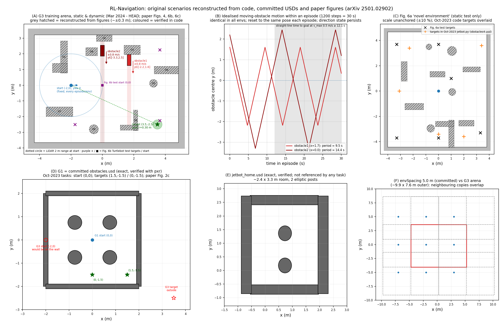

# Phase 2b: Original scenario investigation and revised (native Isaac Lab) plan

**Date:** 2026-11-21
**Supersedes:** §§5–8 of `PHASE2_MIGRATION_REPORT.md` (the faithful-port strategy). §§1–4, 9 and 10 of that report remain valid as background.
**Scope:** analysis and planning only. Nothing was implemented. RL-Navigation, Isaac Lab and the conda env are unchanged; the only Kit run was a read-only USD inspection through `isaacrun`.

| Tag | Meaning |
|---|---|
| **[V]** | Verified in source code, git history, a committed USD (read with pxr), or installed packages |
| **[R]** | Reconstructed from paper figures with a calibrated method; approximate, with the stated uncertainty |
| **[P]** | Stated in the paper text (arXiv 2501.02902v1) |
| **[A]** | Assumption or inference; the reasoning is given |

**Deliverables:**
* **Figure:** `figures/original_scenarios_topdown.png`, a top-down reconstruction of all scenarios.
* **Geometry:** `evidence/scenario_geometry.json`, the reconstructed geometry, machine-readable.
* **Scripts:** `evidence/scenario_reconstruction.py`, `segment_render.py`, `segment_fig6.py` and `usd_bounds.py`.
* **Paper sources:** `evidence/paper_figures/`, the figure crops and renders used.

---

## Summary

1. **The paper's scenarios were developed over three successive generations of the code (G1 → G2 → G3) [V, git history].** The paper's training results (Figs. 3–5, 6c) use the latest generation, **G3**.

   The G3 scene file, `obstacles_dynamic.usd`, was **never committed to any branch or commit** [V]. However, the paper's own top-down renders, plus positions fixed in the code, allow a reconstruction to roughly **±0.3 m**.
2. **G3 is a single, fixed scenario** [V]:
   * one walled arena of about **9.2 × 6.9 m** interior [R];
   * **9 static obstacles**: 2 L-shapes, 5 boxes or bars, 2 cylinders [R];
   * **a fixed start (−2, 0) with yaw 0 and a fixed target (3.5, −2.5)** in every episode and every env [V];
   * in the dynamic variant, **2 boxes moving back and forth along y at 0.8 m/s** in fixed lanes x = 1.7 and x = 0.0 [V]. Their motion is deterministic and identical across envs, with periods of about 9.5 s and 14.4 s [R].

   **Nothing about the layout, poses or goal is randomized in G3** [V]. The only per-episode variation is the observation and action noise bias.
3. **The static and dynamic scenarios differ only by the two moving boxes** [V]: same scene file, same start and goal.
4. **Evaluation largely reused the training conditions.**
   * The paper's quantitative Isaac result (Fig. 5, 30 trials) and Fig. 6c run in the training arena with the training start and goal [V/R].
   * Generalization was shown only qualitatively: Fig. 6b (new targets, same arena) and Fig. 6a (a "novel" arena, static).
5. **Curriculum:** done by hand by restarting from a checkpoint. Static and dynamic G3 share everything except the two boxes, so the curriculum amounts to *adding the moving boxes to a scene the policy has already learned* [V/A].
6. **The committed `envSpacing` of 5.0 m is smaller than the reconstructed G3 arena (about 9.9 × 7.6 m outer)** [V/R]. Either a larger spacing was used in the actual runs, or neighbouring arenas overlapped and could be seen by the LiDAR [A]. It can't be resolved from the evidence.
7. **Reconstruction fidelity:** good enough to reproduce the *character* of G3 (layout density, corridor widths, obstacle lanes, start/goal geometry), but not an exact copy. More importantly, **G3 is a memorizable single-route task**, which matters for the decision about the new environment (§1.11). No decision is made here.
8. **Revised plan:**
   * a clean native `DirectRLEnv` with separate robot, scene, sensor, controller and MDP modules;
   * collision from ground truth;
   * a scenario interface so the final scene and obstacle behaviour stay open;
   * **RSL-RL** as the RL backend.

   **Essential path to a working baseline:** about 18–28 h of AI-assisted implementation, 8–12 h of your validation and review, and 3–8 GPU-hours of training. That is roughly **1–2 calendar weeks**, set mainly by review cycles (§3.3).

---

# Part 1: Original training environment investigation

## 1.1 Evidence available

| Source | Content | Status |
|---|---|---|
| `tasks/jetbot.py`, `jetbot_dynamic.py`, `dynamic_target.py` (HEAD) | Start, target and moving-obstacle poses and motion; scene file names | [V] |
| Git history (12 commits touching tasks/assets, 2023-10 → 2024-11) | Earlier start/target/scene settings | [V] |
| `assets/jetbot/obstacles.usd`, `jetbot_home.usd` | Exact geometry, read with pxr (`usd_bounds.py`) | [V] |
| `obstacles_dynamic.usd` (G3), `obstacles4.usd` (G2), occupancy maps `cost4_0.5.png` (G2), `imgs/new_cost2024.png` (G3) | **Missing; never committed in any commit** (`git log --all --name-status`) | [V] |
| Paper Fig. 2c | Screenshot of `obstacles.usd` in Isaac Sim 2023.1.1. The content browser also shows `obstacles3/5/7/8.usd`, so more scene variants existed | [V] (image) |
| Paper Fig. 2d | Many parallel copies of a G3-like arena, with LiDAR rays | [V] (image) |
| Paper Fig. 4 | Top-down render of the G3 arena with the two red moving boxes, viewed rotated 180° | [V] (image) |
| Paper Fig. 6a/6b/6c | Trajectory plots over top-down renders. **The trajectories are in simulator coordinates; the background images are hand-registered and slightly mis-scaled** | [V] (image), [R] (geometry) |

## 1.2 Three scenario generations [V, git history]

| | **G1** (2023-10-13, `jet_backup.py`) | **G2** (2023-10-30 → 2024-03, `jetbot.py`, `dynamic_target.py`) | **G3** (2024-03-08 → HEAD; **used in the paper**) |
|---|---|---|---|
| Scene | `obstacles.usd` (**committed**): 3.8 × 3.8 m interior, 4 cylinders r = 0.3 | `obstacles4.usd` (missing) | `obstacles_dynamic.usd` (missing; reconstructed §1.3) |
| Start | (0, 0) | (0, 0) + a random cell from the occupancy map `cost4_0.5.png` (0.5 m cells) | **(−2, 0), yaw 0, fixed** |
| Target | (0, −1.5) / (1.5, −1.5) | (−3.1, 0); alternatives in comments: (3.4, 3.6), (2, −3.6), (0, −3.4), (−2.3, 3.4) | **(3.5, −2.5), fixed** |
| LiDAR range | 0.10–20 m | 0.15–1.5 m | 0.15–2.0 m |
| Collision threshold | 0.11 m | 0.30 m | 0.25 m |
| Episode | 500 steps | 1000 steps | 1200 steps (30 s at 40 Hz) |
| Moving things | none | moving **target** (`dynamic_target.py`, −0.35 m/s in x) | 2 moving boxes (`jetbot_dynamic.py`) |

The paper describes G3 values: Min = 25 cm, 1200 steps, 2 m in the deployment section [P]. The Fig. 6c trajectory starts exactly at (−2, 0) and ends 0.28 m from (3.5, −2.5), inside the 0.30 m goal radius [V/R]. The shipped ONNX models with other observation sizes (362 = 360 + 2, 70, 46, …) probably come from G1/G2-era variants [A].

## 1.3 G3 training arena: geometry



**Reconstruction method [R]:**
* Obstacles were segmented in the clean top-down render behind Fig. 6b (`evidence/paper_figures/fig6b_background_render.png`).
* The pixel → world mapping was calibrated from Fig. 6c:
  * three positions known from the code fix x to within 0.03 m: moving-box lanes x = 1.7 and x = 0.0, and the target cube x = 3.5;
  * y is fixed by the target's y and the squareness of the floor grid;
  * the two figures' registrations were matched using 8 obstacles visible in both.
* Result: x = −4.77 + 0.01103·px, y = 3.646 − 0.01099·py.

**Independent checks (all pass):**
1. The derived scale is isotropic (0.01103 vs 0.01099 m/px), as an orthographic top view must be.
2. Box 1 moving upward from its code start (1.7, 1.6) meets the reconstructed bottom face of box O3 at y = 1.95 − 0.35 = **1.60**, exactly its start position. Box 2 starts at 2.2, just below the box it would hit at 2.45.
3. The Fig. 6c trajectory end is consistent with the code target and goal radius.

**Uncertainty:** about ±0.3 m in position and ±0.1 m in size. The Fig. 6b and 6c background registrations disagree by up to 0.4 m before correction.

| Element | Geometry (world frame, env-local) | Tag |
|---|---|---|
| Walls | interior x ∈ [−4.33, 4.85], y ∈ [−3.65, 3.21] (≈ 9.2 × 6.9 m); thickness ≈ 0.4 m | [R] |
| O1 L-shape | bar x [−2.66, −2.22] × y [0.78, 2.82]; foot x [−3.18, −2.22] × y [0.81, 1.39] | [R] |
| O2 box on top wall | x [−0.38, 0.62] × y [2.80, 3.20] | [R] |
| O3 box | x [1.38, 2.41] × y [1.95, 2.55] | [R] |
| O4 box | x [−1.06, −0.31] × y [1.88, 2.40] | [R] |
| O5 cylinder | centre (3.25, 0.12), r ≈ 0.25 | [R] |
| O6 bar on right wall | x [3.30, 4.85] × y [0.73, 1.20] | [R] |
| O7 bar | x [−3.58, −1.88] × y [−1.99, −1.38] | [R] |
| O8 L-shape | bar x [1.98, 2.25] × y [−2.89, −1.59]; foot x [1.14, 2.28] × y [−2.86, −2.54] | [R] |
| O9 cylinder | centre (−0.55, −2.81), r ≈ 0.29 | [R] |
| Obstacle heights | not recoverable from top views. The LiDAR is 2D, so only the cross-section at the scan height matters | unknown |

Free-space character [R]:
* the start is about 0.8 m from O1 and 1.4 m from O7;
* the straight start → goal line (6.0 m) crosses both moving-box lanes and passes close to O8;
* corridor widths are roughly 0.8–2 m, against a Jetbot footprint of about 0.15 m and a 0.25 m collision threshold.

## 1.4 Robot initial pose and goal [V]
* **Start:** (−2, 0, 0) with identity orientation (yaw 0, facing +x), zero velocity, in every episode and every env.
* **Goal:** (3.5, −2.5) in every episode and env. Success when the 3D distance is < 0.30 m. The goal cube is 0.1 m with collision disabled.
* The quaternion round-trip through SciPy in `reset_idx` is a no-op (the identity is preserved). The yaw and occupancy-map randomizations are commented out.

## 1.5 Moving obstacles (dynamic variant) [V unless noted]
* **Number and geometry:** 2 `DynamicCuboid`s, 0.25 × 0.7 × 0.2 m (long axis along y), red, collisions enabled, ordinary (non-kinematic) rigid bodies. They are spawned with their centre at z = 0, i.e. half below the ground, and are presumably pushed up by depenetration [A].
* **Lanes:** box 1 at x = 1.7, starting at y = 1.6; box 2 at x = 0.0, starting at y = 2.2.
* **Motion:**
  * Every control step, the USD velocity attribute is overwritten with v_y = ±0.8 m/s. Both start moving in −y.
  * The direction flips when the box's displacement over a step is ~0 (`atan2(Δy, Δx)` ≈ 0), i.e. when it is blocked by a wall, an obstacle or the robot.
  * Resulting bounce ranges [R]: box 1 y ∈ [−2.19, 1.60], period ≈ 9.5 s; box 2 y ∈ [−3.30, 2.45], period ≈ 14.4 s (Fig. panel B).
* **Robot interaction:** the boxes can be pushed by the robot, or reverse on contact with it (a contact sets displacement ≈ 0).
* **Reset:** on each episode reset, both boxes are teleported back to their initial poses, but the **direction state is not reset**. Successive episodes can therefore start with either direction.
* **Across envs:** identical motion pattern in all envs (no per-env phase or speed). The per-env speed variation is commented out.
* **Paper vs code:** in Gazebo the paper uses a moving box at 0.1–0.3 m/s [P]; the code's Gazebo script uses 0.24 m/s, reversing every 20 s [V].

## 1.6 Randomization across episodes and parallel envs

| Item | G3 (paper) | Evidence |
|---|---|---|
| Arena layout | identical in all envs: one USD referenced in env_0 and cloned | [V] |
| Robot start pose / yaw | fixed | [V] (randomizations commented out) |
| Replicator position DR (`[-2,2]` in YAML) | configured but never triggered (no `step_randomization` call) | [V] code, [A] effect |
| Goal | fixed | [V] |
| Moving-obstacle motion | identical and deterministic (except the direction memory and robot pushes) | [V] |
| Observation / action noise | per-env Gaussian **bias**, resampled each episode (σ = 0.2 / 0.05) | [V] |
| Earlier randomization (G2) | random occupancy-map start, but **one sample shared by all envs reset in the same call**, not per env | [V] |
| Paper statement | "the robot's starting position was carefully chosen to align with the training setup, where it consistently began in relatively free space" | [P] |

**Consequence [A]:** the 64 parallel envs are 64 copies of the same episode, differing only in noise bias and policy sampling. The task is effectively a single route with timed obstacles. A policy can solve it by memorizing that route and the obstacles' timing rather than by learning general LiDAR-reactive navigation. This is consistent with the paper's own remark that real-world starts had to match the training setup.

## 1.7 Static vs dynamic training scenarios [V]
| | Static (`jetbot.py`) | Dynamic (`jetbot_dynamic.py`) |
|---|---|---|
| Scene | G3 arena | same G3 arena |
| Start / goal | (−2, 0) → (3.5, −2.5) | same |
| Moving boxes | none | 2 (§1.5) |
| Obs / action / reward | 133 dims / [v, ω] / identical | identical, so checkpoints are interchangeable |
| Sim setting | `use_flatcache: False` in the committed YAML (a comment says to set it to True for static training) | must be False for the USD velocity writes to take effect |

## 1.8 Training vs evaluation environments
| Evaluation | Scene | Start → goal | Relation to training |
|---|---|---|---|
| Fig. 3 | training curves | n/a | n/a |
| Fig. 6c + Fig. 5 (30 trials, quantitative) | G3 arena **with** moving boxes [R] | (−2, 0) → (3.5, −2.5) [V/R] | **Same as training** |
| Fig. 6b (Turtlebot3) | G3 arena, static [R] | (0, 0) → about (3.65, 2.25), (3.65, −2.25), (−1.75, −2.5) [R] | Same arena, new start and goals. Note this uses a *different robot*, which needs different wheel and LiDAR parameters [P] |
| Fig. 6a (Jetbot) | "novel environment" [P], about 7.8 × 9.1 m interior, 7 boxes or bars + 4 cylinders [R, scale unanchored ±10 %] | (0, 0) → 6 targets near (±3.3, ±3.7), (0, ±3.7), (1, 1) | New arena, static only. Its targets resemble G2's coded targets, so it is **possibly `obstacles4.usd`** [A] |
| Gazebo (Fig. 7) | TurtleBot3 worlds + 1 moving box at 0.1–0.3 m/s | n/a | different simulator |
| Real world (Table 1) | 4 lab layouts with novel obstacles; people as dynamic obstacles | starts chosen to match training | different |

## 1.9 Curriculum procedure
* **Paper [P]:** train in the static environment; "after 300 initial steps, we added dynamic objects and continued the training".
* **Code [V]:** none. There's no curriculum hook and no shared task class (the two tasks are separate files with the same class name, and only `Jetbot` is registered).
* **Most likely procedure [A]:**
  1. train the `Jetbot` task (static G3) with rl_games;
  2. register or rename `jetbot_dynamic.py` as the task, set `use_flatcache: False`;
  3. restart with `checkpoint=<static run>.pth`.

  This works because the observations, actions and network are identical.
* **"300 steps":** most likely 300 rl_games epochs [A]. Fig. 3's x-axis is labelled "Episode" (0–1000), while the text says 1500 iterations, so the unit is ambiguous.
* **The curriculum's content:** since start, goal and arena are shared, the curriculum is "learn the fixed route, then learn to time and avoid two boxes crossing it" [A].

## 1.10 Unresolved: environment spacing [V/R/A]
* The committed `envSpacing` is 5.0 m (all commits), but the G3 arena is about 9.9 × 7.6 m outer (Fig. panel F).
* With 5 m spacing, neighbouring arenas would overlap by several metres. The PhysX LiDAR scene queries are not filtered per env [A], so they would see neighbouring walls, boxes and robots within 2 m.
* Fig. 2d shows clearly separated arenas with about one grid cell between them, which suggests a larger spacing was used for at least that run [A].
* Neither case can be confirmed. Either way, it doesn't affect a new native design: `MultiMeshRayCaster` targets are per env, so this class of artefact disappears.

## 1.11 Can the original scenarios be reconstructed with sufficient fidelity?

| Aspect | Fidelity achievable | Comment |
|---|---|---|
| G3 arena layout (walls, 9 obstacles) | **±0.3 m position, ±0.1 m size** [R] | Enough to reproduce corridor structure and difficulty; obstacle heights unknown (irrelevant for 2D LiDAR, relevant for future 3D sensing) |
| Start, goal, thresholds, episode length | **exact** [V] | |
| Moving boxes (size, lanes, speed, bounce logic) | **exact in code** [V]; bounce limits ±0.3 m [R] | Bounce timing depends on the reconstructed obstacle faces |
| Randomization | **exact** (there is none) [V] | |
| G1 arena | **exact** (committed USD) [V] | Small (3.8 m), different start and goal |
| Fig. 6a test arena | ±10 % scale, unanchored [R] | Useful only as a qualitative generalization layout |
| G2 occupancy-map start distribution | **not recoverable** | Map file missing |
| Env spacing actually used | **unknown** | §1.10 |

**Assessment.** G3 can be rebuilt to a fidelity that preserves its character; `scenario_geometry.json` is directly usable as a scene definition. Faithful geometry, however, doesn't remove the scenario's structural limitations:
* a single fixed route, no start or goal variation, deterministic and env-identical obstacles;
* quantitative evaluation on the training configuration;
* 2D-only geometry with unknown heights.

These limitations matter more for your long-term goal (adaptive spatiotemporal sensing, §9 of the phase 2 report) than the ±0.3 m geometric error does.

**Options for our joint decision** (no decision taken):

| Option | What it means | Cost | Main consequence |
|---|---|---|---|
| **Preserve/reconstruct G3** | Build the G3 arena from `scenario_geometry.json` with the fixed start/goal and 2 boxes | Lowest (≈ 1–2 h on top of the scene module) | Comparable to the paper qualitatively; same memorization risk; weak test of sensing |
| **Reconstruct + randomize** | G3 (and optionally the Fig. 6a layout) as fixed layouts, with randomized start/goal (free-space sampling with a minimum distance), randomized obstacle speeds, phases and lanes, and per-env variation | Low–medium (+2–4 h) | Keeps continuity with the paper while making the task a navigation *distribution*; a held-out layout gives real generalization tests |
| **Redesign (procedural)** | Generator of arenas, obstacle sets (incl. 3D heights) and motion models; G3 retained as one fixed evaluation scene | Medium (+4–8 h) | Best foundation for phase 3 (3D, limited FOV, occlusion, surprise); departs from the paper |

The plan in Part 2 supports all three through the same scenario interface, so the decision can be made after the review without rework.

---

# Part 2: Revised migration strategy

## 2.1 Principles
1. **Native and clean:** `DirectRLEnv`; all per-step work batched on the GPU (no Python loops over envs, no `.item()`, no USD writes during stepping).
2. **The original repo is a methodological reference only.** Keep:
   * the robot class and action semantics (unicycle v, ω with v_min > 0, optionally allowing stop);
   * the observation ingredients (pooled LiDAR + goal polar coordinates + motion state);
   * the reward ingredients (progress, proximity, terminal goal/collision);
   * 40 Hz control, a 2 m LiDAR, PPO with optional LSTM.

   Drop the legacy quirks (§2.4).
3. **Reuse what Phase 2 validated:**
   * `MultiMeshRayCaster` with `track_mesh_transforms=True` for moving targets;
   * moving obstacles as **gravity-free dynamic rigid bodies driven by `write_root_velocity_to_sim`** (0 errors at 4096 envs);
   * **no kinematic bodies with per-step pose writes** (crash, R5).
4. **Ground-truth collision from day one;** the policy's own sensor never defines collision or the penalties.
5. **The scenario stays open:** the scene, start/goal sampling and obstacle motion are pluggable configs.
6. **Extensible sensing:** sensor output is a structured record, not a fixed vector, so the Mirrorcle 3D LiDAR and adaptive patterns can be added without touching the MDP.

## 2.2 Module architecture

```
source/st_nav/st_nav/
├── robots/jetbot.py          ArticulationCfg (explicit drive gains), wheel radius/track as cfg (calibrated in E1)
├── control/diff_drive.py     DiffDriveController: (v, ω) → wheel velocity targets, batched; limits + optional accel limits
├── scenes/
│   ├── scenario_cfg.py       ScenarioCfg: layout source + StartGoalSampler + ObstacleMotionModel (all swappable)
│   ├── layouts.py            primitive-based layouts: from JSON (e.g. reconstructed G3, Fig 6a, G1) or procedural
│   ├── obstacles.py          static colliders (Cuboid/Cylinder cfgs per env) + moving obstacles (RigidObjectCollection,
│   │                         gravity off, velocity-commanded); motion models: none | bounce_lane (G3-like) | random_waypoint ...
│   └── sampling.py           free-space start/goal sampling on a per-layout occupancy grid (GPU), min distances
├── sensors/
│   ├── base.py               RangeSensor interface → SensorOutput(ranges, dirs_b, valid, t_stamp, hit_w) + num_rays_max
│   ├── lidar2d.py            fixed-pattern 2D LiDAR on MultiMeshRayCaster (360 rays, 0.15–2 m), noise/dropout hooks
│   └── (phase 3) mirrorcle.py, adaptive patterns writing ray_directions per env per step under an R_max mask
├── mdp/
│   ├── observations.py       encoders: pooled beams (e.g. 360→120 min-pool), goal (d, sinθ, cosθ) in robot frame, v/ω, a_{t-1}
│   ├── rewards.py            term functions returning per-term tensors (logged individually)
│   ├── terminations.py       goal, ground-truth collision, timeout (as truncation)
│   └── collision.py          analytic 2D clearance to known primitives (exact, also gives clearance metric) + ContactSensor backstop
├── tasks/nav2d/
│   ├── nav_env_cfg.py        DirectRLEnvCfg: composes the modules; obs groups {"policy", "critic"}
│   ├── nav_env.py            DirectRLEnv: ~200 lines that only wire modules together
│   └── agents/rsl_rl_ppo_cfg.py   MLP and LSTM runner cfgs
└── eval/                     evaluator (deterministic policy, fixed seeded scenario suites) + metrics
scripts/  train.py, play.py (thin wrappers over Isaac Lab's RSL-RL scripts), evaluate.py, plot_scene.py, record_rollouts.py
configs/eval/*.yaml           frozen evaluation suites (layout + start/goal sets + obstacle motion seeds)
tests/                        pytest: diff drive, sampler, clearance function, reward terms, LiDAR analytic geometry
```

**Key interfaces:**
* `RangeSensor.update(dt) -> SensorOutput` carries **validity mask** and **per-ray timestamps** from the start. With the fixed 2D LiDAR, all timestamps are equal and the mask is all-true, so this costs nothing now.
* Observation encoders consume a `SensorOutput`, so the MDP never needs to know which sensor produced it.
* `ScenarioCfg` = `layout` × `start_goal_sampler` × `obstacle_motion`. Training curricula and evaluation suites are just different `ScenarioCfg` instances.

**Why analytic clearance for ground-truth collision [A, design]:**
* Layouts are built from primitives (boxes, cylinders) whose poses are known on the GPU, including moving obstacles. A batched 2D signed-distance from the robot footprint to every primitive is exact, cheap, works identically for moving bodies, and also provides the clearance and proximity signals.
* A chassis `ContactSensor` (articulation spawned with `activate_contact_sensors=True`) serves as an independent backstop and a test oracle.
* The proximity penalty uses the same ground-truth clearance. The policy's LiDAR is used only for observations.

## 2.3 MDP baseline (methodology retained, bugs removed)
| Component | Baseline choice | Change vs original |
|---|---|---|
| Control | 40 Hz (`decimation=3`, `dt=1/120`), actions in [−1, 1] → v ∈ [v_min, v_max], ω ∈ [−ω_max, ω_max] mapped in `_pre_physics_step` | Explicit, documented mapping; v_min configurable (0.1 legacy or 0 to allow stopping) |
| Observation (policy) | pooled LiDAR (120 × 3° min-pool, normalized by range), goal distance + sin/cos of heading in the robot frame, body-frame v and ω, previous action | No 5× repetition; robot frame instead of world frame; previous action added (paper's v_{t−1}, ω_{t−1}) |
| Observation (critic) | policy obs + ground-truth clearance and nearest-obstacle relative states (privileged) | New (asymmetric critic), optional at first |
| Reward | progress `k·(d_{t−1} − d_t)` with d_prev reset per env; ground-truth proximity penalty (smooth, e.g. exponential below a margin); terminal goal +R; collision −R; small time penalty or the paper's remaining-time bonus; optional action-smoothness term | Fixes the never-reset `prev_goal_distance` (≈ −60 spike); no double-counted potential; no hard-coded dt; penalties on ground truth |
| Terminations | goal (2D distance < 0.30 m), ground-truth collision (clearance < 0), timeout as **truncation** (bootstrapped) | Timeout no longer treated as failure in value targets |
| Resets | per-env start/goal from the scenario sampler; per-env obstacle phases/speeds when the scenario says so | Randomization is per env and actually triggered |
| Noise | sensor-level per-ray noise/dropout in the sensor module; small observation noise via `observation_noise_model` | No blanket σ = 0.2 bias on all dims |

## 2.4 Dropped from the plan (per your instructions)
* `legacy_exact` reward modes and paper-parity experiments.
* Comparison with the PhysX LiDAR.
* Gazebo.
* ONNX export (RSL-RL's `play.py` can export JIT/ONNX later at no extra cost).
* The 133-dim legacy observation layout and the 5× repetition.
* rl_games-specific tooling.

## 2.5 RL backend: reconsidered
With parity no longer required, the main reason for rl_games is gone. Comparison against the installed versions:

| Criterion | **RSL-RL 5.0.1** | rl_games 1.6.1 | SKRL 2.1.0 |
|---|---|---|---|
| Isaac Lab integration (train/play scripts, wrapper, cfg classes) | First-class [V] | Supported [V] | Supported [V] |
| Recurrent policies | Built in: `RslRlRNNModelCfg` (LSTM/GRU) [V] | Built in (`network.rnn`) [V] | Supported via custom models [V] |
| Asymmetric actor-critic | `obs_groups` mapping (policy/critic) [V] | `states` ← critic group [V] | Yes (separate models) [V] |
| Discrete / multi-discrete actions | **Not shipped; only Gaussian.** PPO is written against an abstract `Distribution` interface (`params`, `log_prob`, `entropy`, `kl_divergence`), and models load a distribution via `distribution_cfg.class_name` [V]. A categorical or **hybrid Gaussian + multi-categorical** distribution can be plugged in without forking [A: not runtime-tested]. The Isaac Lab wrapper presents actions as a flat `Box` [V], so discrete indices travel as floats | Discrete and multi-discrete built in [V]; hybrid not built in | Categorical and MultiCategorical built in [V]; hybrid not built in |
| Export | JIT + ONNX in `play.py` incl. RNN state [V] | none in Isaac Lab [V] | partial |
| Maintenance / ecosystem | Actively developed with Isaac Lab; most Isaac Lab examples | Mature, slower development | Active |

**Recommendation: RSL-RL** as the single backend.
* It has the tightest integration, built-in LSTM, critic observation groups and export.
* Its distribution interface is the cleanest route to the likely phase-3 need: **continuous motion + discrete or multi-discrete sensing choices in one policy** (a hybrid action that none of the three libraries ships).
* Until then, prefer **continuous sensing parameters** (no custom code needed).
* An early optional half-day spike (O7) validates a custom categorical/hybrid distribution before phase 3 depends on it. Fallback for purely discrete sensing: SKRL.

---

# Part 3: Implementation plan

## 3.1 Essential path (functional baseline as fast as possible)

The interim scenario used for development is whichever is cheapest to validate: **reconstructed G3 with randomized start/goal**. Because the scenario is a config, the final choice after our review is a swap, not a rewrite.

| # | Task | Gate (must pass before the next) |
|---|---|---|
| **E0** | External project scaffold (`source/st_nav`, `pip install -e` **into a user-level path, not the shared env**, or via `PYTHONPATH` from `env.sh`), gym registration, `isaacrun` integration, git repo | `list_envs` shows `STNav-Nav2D-v0`; a zero-action env steps headless at 1024 envs |
| **E1** | Robot + diff-drive controller; action mapping | Open-loop test: commanded vs measured body v/ω within 5 % at several setpoints; wheel track calibrated |
| **E2** | Scene module: layout from JSON (G3 reconstruction), static primitives per env, moving obstacles (velocity-commanded dynamic bodies, bounce-lane model), free-space start/goal sampler | Offline top-down plot (no rendering needed) of N sampled envs: no spawn overlaps, obstacles move as specified, per-env variation present |
| **E3** | Sensor module: `RangeSensor` interface, `Lidar2D` on `MultiMeshRayCaster` (static + tracked moving targets), pooling encoder | Analytic tests (as in the Phase 2 probe) within 1 cm, including moving obstacles; throughput measured at 1024/4096 envs |
| **E4** | MDP: observations (policy, critic), reward terms, terminations with ground-truth clearance + ContactSensor backstop, resets | pytest on reward/termination/clearance functions with synthetic batches; random-policy episodes show plausible collision and timeout rates; GT clearance agrees with ContactSensor on collisions |
| **E5** | PPO training (RSL-RL, MLP) with checkpoints, TensorBoard, per-term reward logging | Return rises and success rate rises on the interim scenario; checkpoints resume correctly; 2 seeds |
| **E6** | Evaluation framework: deterministic policy over frozen seeded suites; metrics to CSV/JSON | Same seed → identical metrics; report: success / collision / timeout, time-to-goal, path length, SPL, min/mean GT clearance, command smoothness; per-suite breakdown (static, dynamic, held-out layout if available) |

## 3.2 Optional improvements (after the baseline works)
| # | Item | Why / when |
|---|---|---|
| O1 | LSTM policy (`RslRlRNNModelCfg`) | Expected to help with moving obstacles; cheap to add |
| O2 | Asymmetric critic with privileged obstacle states | Usually faster, more stable learning; important for phase 3 partial observability |
| O3 | Procedural layout generator (incl. 3D heights) and richer obstacle motion models | If "redesign" is chosen; prerequisite for 3D sensing studies |
| O4 | Scenario curriculum (static → dynamic, easy → hard) as a config schedule | Replaces the manual checkpoint hand-off |
| O5 | Sensor realism: per-ray range noise, dropouts, angular jitter | Before sim-to-real or sensing studies |
| O6 | Rollout recorder (npz) + offline trajectory/scan plots | Visual inspection while rendering is unavailable |
| O7 | Spike: custom categorical/hybrid distribution in RSL-RL; runtime test of per-env, per-step `ray_directions` rewrites with an R_max mask | De-risks phase 3 action and sensor design |
| O8 | Multi-GPU training (`isaacrun -g 2,3 … torch.distributed.run`) | Only if single-GPU wall-clock becomes limiting |
| Later | ONNX export, ROS 2 SIL in Isaac Sim, real robot | Phases 4+ |

## 3.3 Effort estimates (AI-assisted)
Definitions:
* **Implementation** = time for me to write the code and tests, in focused working hours, including iterations on failures that I can observe directly in headless runs.
* **Your validation** = reviewing code and plots, answering design questions, deciding on gate results.
* **GPU** = actual training/evaluation compute on one A6000.

Training-time figures are estimates [A]. Measured: the ray-cast-only probe reached 538k env-steps/s. With the articulated robot and decimation 3, I expect **roughly 50–150k env-steps/s at 4096 envs**; E3 measures this.

| # | Implementation | Your validation | GPU time |
|---|---|---|---|
| E0 | 1–2 h | 0.5 h | – |
| E1 | 2–3 h | 0.5–1 h | minutes |
| E2 | 3–5 h | 1–2 h | minutes |
| E3 | 2–3 h | 0.5–1 h | minutes |
| E4 | 4–6 h | 2–3 h | minutes |
| E5 | 2–4 h (incl. first tuning loop) | 2–3 h | **2–6 h** (MLP: about 20–60 min per run for ≈ 100–300 M env-steps; 3–6 runs incl. seeds and tuning) |
| E6 | 3–4 h | 1–2 h | < 30 min per full evaluation |
| **Essential total** | **≈ 18–28 h** | **≈ 8–12 h** | **≈ 3–8 GPU-h** |
| O1 + O2 | 2–3 h | 1 h | 2–4 h (LSTM ≈ 2–3× slower per step) |
| O3 + O4 | 4–8 h | 2–3 h | 2–6 h |
| O5 + O6 | 3–4 h | 1 h | – |
| O7 | 3–4 h | 1 h | < 1 h |

**Calendar:** the essential path is about **1–2 weeks**, dominated by review cycles at the gates rather than coding. Training runs proceed unattended under `isaacrun` (tmux/nohup), one GPU per run. Several seeds or variants can run in parallel on different GPUs, subject to the shared-server etiquette in the README.

## 3.4 Risks specific to the revised plan
| Risk | Mitigation |
|---|---|
| Throughput with articulation + ray caster lower than expected | Measured in E3; reduce rays (e.g. 180 at 2°) or envs; the per-step cost is dominated by physics, not ray casting [A] |
| Reward retuning without legacy parity anchors | Per-term logging from E5; begin from paper-like magnitudes; gates judged on success/collision metrics, not return values |
| Hybrid/discrete actions in RSL-RL untested | O7 spike before phase 3; SKRL fallback |
| Kinematic pose-write crash (Phase 2 R5) | Not used anywhere in the design |
| Installing the extension must not modify the shared conda env | E0 uses a user-level install or `PYTHONPATH` via `env.sh`, to be confirmed with you at E0 |
| No rendering | All validation via numeric tests and offline matplotlib plots |

## 3.5 Decisions needed from you after this review
1. **Scenario:** preserve G3, reconstruct + randomize, or redesign (procedural) — §1.11.
2. **Moving-obstacle behaviour:** G3 bounce lanes, randomized lanes/speeds/phases, or general motion models (random waypoints, crossing pedestrians).
3. **Action limits:** keep v_min = 0.1 m/s (cannot stop) or allow stopping/reversing.
4. **Target platform:** Jetbot as a stand-in now; which real robot, and its control rate, for later phases (affects robot config and control frequency).
5. **E0 install method** for the extension, without touching the shared conda env.
