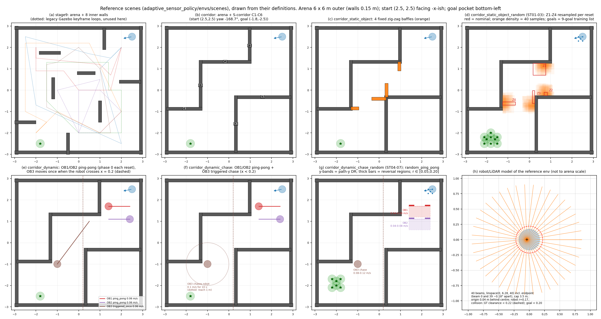

# Phase 3 (planning): Native Isaac Lab navigation environment from the `adaptive_sensor_policy` reference

**Date:** 2026-11-21
**Status:** findings and roadmap for review. **No development started.** The reference repositories (`~/adaptive_sensor_policy`, `~/turtlebot3_drlnav`), Isaac Lab and the conda env were only read:
* the reference repo's `git status` is unchanged from before this work (only your own pending ST06/ST07 files);
* scene modules were imported with bytecode writing disabled;
* one read-only Kit run inspected the Create3 asset.

**Tags:**
* **[V]** verified in code, assets or installed packages;
* **[M]** measured earlier on this server (Phase 2);
* **[A]** assumption or estimate.

**Files:**
* `figures/reference_scenes_topdown.png`: all 9 scenes, drawn from their definitions;
* `tools/plot_reference_scenes.py`: script that produces the figure.

---

## 0. Summary

1. **The reference environment is a pure 2D analytic simulator** [V]:
   * oriented-box walls and circular moving obstacles in a 6 × 6 m arena;
   * a kinematic unicycle robot at 5 Hz, with an optional exact actuator delay / first-order-lag / gain model;
   * a 40-beam analytic ray caster (3.5 m cap, datasheet noise);
   * ground-truth (geometric) collision.

   **Every element maps onto batched GPU tensor operations.** Nothing in it requires CPU-side logic per env.
2. **Scenes** [V]: 9 registered scenes in two families:
   * **Stage 9:** open arena with 8 inner walls.
   * **S-corridor (C1–C6):** used by all current experiments, in two variants:
     * static zig-zag baffles Z1–Z4, randomized per reset (ST01–03);
     * up to three moving obstacles (ST04–07): OB1/OB2 on a stochastic "random ping-pong" process with random reversal points and pauses, and OB3 a triggered robot-chaser.

   All are plotted from their definitions in the figure.
3. **Translation is feasible without blockers.** Two robot modes share one interface:
   * **Mode K (kinematic, reference-faithful; recommended for the baseline):**
     * the unicycle + actuator model is integrated in torch exactly as in the reference;
     * robot and obstacles are written as poses of gravity-free rigid bodies, a mechanism verified in Phase 2;
     * `MultiMeshRayCaster` casts the 40 beams;
     * expected throughput is very high (§3.6).
   * **Mode A (articulated TurtleBot4):** the Create3 base (`iRobot/Create3/create_3.usd`, in Isaac Sim 5.1 assets [V]) plus a TB4 Standard top structure, driven by wheel velocities. This is the physics-fidelity step, added after the baseline works.
4. **One real limitation found [V]:** `MultiMeshRayCaster` bakes each mesh's **scale** at initialization and afterwards tracks only **pose**. Per-reset *size* randomization therefore needs a workaround:
   * baffle length/thickness DR and obstacle radius DR are handled by per-env sampling at spawn plus radius bins (§3.4);
   * position, offset, presence and speed DR are unaffected.
5. **The navigation MDP combines the three sources:**
   * observation in drlnav style: 40 normalized beams + goal distance/heading + previous action, plus measured velocities;
   * reward: progress + proximity + time + terminal success/collision;
   * **all reward and termination terms are computed from ground-truth scene geometry, never from the LiDAR.** This requirement is satisfied by construction, because the scene state lives in torch tensors.
6. **RL backend: RSL-RL** (rationale in Phase 2b §2.5; unchanged).
7. **Essential path to a working PPO baseline:**
   * about 20–30 h of AI-assisted implementation;
   * about 8–12 h of your review;
   * a few GPU-hours.

   That is roughly **1–2 calendar weeks**, with a throughput gate and a navigation-performance gate.

---

## 1. Reference repository investigation

### 1.1 What is relevant [V]
| Path | Content | Reuse |
|---|---|---|
| `envs/scenes/_common.py` | Arena (6 m walls, 0.15 m thick), S-corridor C1–C6, OB1–OB3 specs, chase duration | **Port as data** (geometry tables) |
| `envs/scenes/<scene>.py` (9 files) | `WALLS`, `MOVING_OBSTACLES`, `SUPPORTED_DR`, scene-specific DR ranges and samplers | **Port as data + samplers** (numpy → torch, or keep on CPU for evaluation seeds) |
| `envs/scenes/_obstacle_motion.py` | Motion types: `ping_pong`, `triggered_once`, `triggered_chase`, `random_ping_pong`, legacy `keyframe`; presence/speed/path-y/radius DR; per-obstacle seeded streams | **Port the logic** (vectorize per env) |
| `envs/turtlebot_var_scan_rate.py` | Sensing env around a frozen TD3: robot integration with actuator model, analytic ray cast, GT clearance, start/goal handling, native LiDAR timing, sector gating | **Port:** robot model, GT clearance, LiDAR constants, start/goal logic. **Not ported now:** sector gating and native timing (sensing research, later) |
| `~/turtlebot3_drlnav/.../reward.py`, `settings.py`, `drl_environment.py` | TD3 navigation MDP (state, reward A, thresholds), trained in Gazebo Stage 9 | **Methodological reference** for observation and reward |
| `AdaptiveFPS/config/*`, `eval/*` | Experiment configs (goal lists, DR flags, episode length) and evaluation results | **Scenario presets and benchmark numbers** |
| `tools/plot_scene.py` | Existing scene plotter | Superseded for our purposes by `tools/plot_reference_scenes.py` |

### 1.2 Maps and geometry [V]
* **Wall format:** `(cx, cy, length, yaw[, thickness])`, an oriented rectangle. Default thickness 0.15 m.
* **Arena:** 4 outer walls centred at ±2.91 m, each 6.0 m long, so the interior is ±2.835 m (5.67 m square).

| Scene | Static geometry | Moving obstacles | Scene DR |
|---|---|---|---|
| `stage9` | arena + 8 inner walls (1.0/0.85 m) | none (legacy Gazebo keyframe loops defined but unused) | – |
| `corridor` | arena + S-corridor C1–C6 (1.66–2.66 m walls) | none | – |
| `corridor_static_object` | + 4 fixed baffles (0.375–0.675 m) | none | – |
| `corridor_static_object_random` (ST01–03) | + Z1–Z4 baffles anchored to C1/C5/C6/C4 | none | `static_obstacle_dr` |
| `corridor_dynamic_ob3` | corridor | OB3 `triggered_once` 0.1 m/s | – |
| `corridor_dynamic` | corridor | OB1, OB2 `ping_pong` 0.06 m/s; OB3 `triggered_once` 0.06 m/s | – |
| `corridor_dynamic_chase_ob3` | corridor | OB3 `triggered_chase` 0.1 m/s for 10 s | – |
| `corridor_dynamic_chase` | corridor | OB1, OB2 ping-pong + OB3 chase | – |
| `corridor_dynamic_chase_random` (ST04–07) | corridor | OB1, OB2 `random_ping_pong` + OB3 chase | presence, speed, path-y, radius |

**Z1–Z4 randomization** (per reset, `sample_static_obstacles_params`):
* lengths are drawn in pairs, in a 50 % "hard" / 50 % "normal" mode;
* lengths 0.10–0.60 m, thicknesses 0.15–0.60 m;
* offsets: Z1/Z2 x ∈ [−0.5, 0], Z3/Z4 y ∈ [−0.55, 0];
* constraints: corridor clearances C12, C34 ≥ 0.75 m, and d(Z1, Z3) ≥ 0.70 m;
* measured over 2000 samples: min C12 = C34 = 0.75 m, min d(Z1, Z3) = 0.774 m.

### 1.3 Moving-obstacle dynamics [V]
* **Shape:** all obstacles are circles (cylinders), radius 0.17 m by default.
* **`ping_pong`:** a deterministic triangle wave between start and end, phase 0 at each reset.
* **`triggered_once`:** waits at start until the robot crosses x = 0.2 m (decreasing), then moves once to end.
* **`triggered_chase`:** after the same trigger, moves toward the robot's *current* position at `speed`, for `chase_duration` = 10 s (50 control steps), then stops.
* **`random_ping_pong`** (OB1, OB2 in ST04–07) — **the stochastic ("Markovian") process.** Its state is (path coordinate s, direction, next reversal target, pause remaining):
  * at reset, s₀ ~ U(0, L) and the direction is uniform ±1;
  * each reversal target is drawn uniformly from the reversal region ahead (outer 25 % at each end);
  * at each reversal there is a pause ~ U(4.6, 5.0) s ("the physical obstacles stop and turn 180°");
  * per-episode speed ~ U(0.04, 0.08) m/s; path y ~ U(OB1 [1.20, 1.70], OB2 [0.60, 1.10]) with gap ∈ [0.55, 0.65] by rejection;
  * radius ~ U(0.05, 0.20) when radius DR is on;
  * presence: each obstacle present with p = 0.5, at least one present.
* **Randomness streams:** independent per-obstacle numpy streams seeded from one obstacle seed per episode, so a given episode seed always produces the same obstacle realization.
* **Update rate:** obstacles are updated **once per control tick** (0.2 s). OB3's chase step is `min(speed·dt, distance)`.

### 1.4 Robot and goals [V]
* **Robot model:** kinematic unicycle with radius 0.17 m.
  * v_max 0.22 m/s, ω_max 2.0 rad/s, backward motion enabled (v ∈ [−0.22, 0.22]).
  * Control at 5 Hz (`control_dt` = 0.2 s); episode 70 s = 350 steps.
* **Actuator DR**, fitted to real TurtleBot4 step responses:
  * delay ~ N(0.15, 0.02) truncated to [0.10, 0.18] s;
  * τ_v ∈ [0.05, 0.10] s, τ_ω ∈ [0.02, 0.07] s;
  * gains k_v ∈ [0.98, 1.02], k_ω ∈ [0.95, 1.05];
  * integrated exactly (closed form) per piece.
* **Start pose:** (2.5, 2.5), yaw −168.7°. Start DR picks one of 5 points within 0.2 m, with yaw π ± 10°.
* **Goals:**
  * default (−1.8, −2.5);
  * ST01–03 use a 9-goal list around it, ST04–07 a 6-goal list around (−2.0, −1.9);
  * the env also supports random free-space start/goal, with ≥ 0.3 m wall margin and ≥ 1.0 m start–goal distance.
* **Thresholds:** goal < 0.20 m; collision when the ground-truth clearance (robot centre to nearest surface) is < 0.22 m (radius 0.17 + 0.05 margin).

### 1.5 Observation, action and reward in the existing implementations [V]
| | drlnav TD3 (Gazebo Stage 9; the frozen navigator) | Reference sensing env (around the TD3) | Paper / Isaac Gym (Phase 2) |
|---|---|---|---|
| Observation | 40 beams / 3.5 (clipped [0, 1]) + d_goal / 5.94 + θ_goal / π + previous normalized (v, ω) = **44** | sensing obs (49); the TD3 still gets the 44-dim input | 120 pooled beams + heading×5 + distance×5 + world v + ω |
| Action | tanh [−1, 1]² → v = a·0.22, ω = a·2.0 | 4 × discrete sector rates | [v, ω] rescaled |
| Reward | **A:** −\|θ_goal\| − ω² + (2d₀/(d₀+d) − 1) − 20·[LiDAR min < 0.22] − ((0.22 − v)·10)² − 1; +2500 success / −2000 collision | navigation part = **10·(d_{t−1} − d_t)/d₀**; ±15 terminal (success / collision / timeout); minus frame costs | progress (twice), stepwise proximity, time bonus, ±30 terminal |
| Collision | LiDAR min < 0.13 m (Gazebo) | **GT clearance < 0.22 m** | LiDAR min < 0.25 m |

**Observations:** drlnav's proximity term and collision both use the **LiDAR**; the reference sensing env already moved collision to ground truth. drlnav's linear-velocity term −((0.22 − v)·10)² strongly rewards driving at v_max. With backward motion enabled that is a large shaping bias, and it would also tie the time-efficiency term to a speed rather than to the outcome.

### 1.6 Existing LiDAR model [V]
* **Beams:** 40 beams at `linspace(0, 6.28, 40, endpoint=True)`, a quirk: spacing 9.23°, and beams 0 and 39 are almost coincident (0.18° apart).
* **Range and placement:** cap 3.5 m; origin 0.04 m behind the robot centre; height 0.171 m from the robot model comment; analytic intersection.
* **Noise:** datasheet relative accuracy, uniform ±a(d)·d, with a = 1 % up to 3 m, 2 % up to 5 m, 2.5 % beyond.
* **Native timing model:** scans every 0.1228 / 0.1351 s (mean 7.4–7.8 Hz, DR) with receive-delay quantiles. The control tick uses the latest scan that has arrived.

---

## 2. Top-down visualizations



Panels (a)–(g) show every scene with:
* walls at true thickness;
* start pose and start-DR points;
* goal sets with the 0.20 m goal radius;
* moving-obstacle paths, trigger line, chase reach, path-y DR bands and reversal regions.

Panel (d) overlays 40 Z1–Z4 samples on the nominal layout (red). Panel (h) shows the robot/beam model.

**Route character:**
* In all corridor scenes the free space forms one S-shaped route from the top-right start, down the right side, left between C2 and C5, down between C3 and C6, and left into the bottom-left goal pocket.
* The narrowest fixed passage is about 0.65 m, against a robot diameter of 0.34 m.
* The baffles create gaps down to 0.75 m nominal clearance.

---

## 3. Feasibility in Isaac Lab 2.3.2

### 3.1 Architecture: the scene state is the source of truth
One torch **`SceneState`** per env holds:
* wall boxes `(W, cx, cy, hx, hy, yaw)`;
* obstacle centres, radii, active mask and motion state;
* robot pose and velocity;
* goal.

All MDP quantities come from it via batched analytic functions:
* ground-truth clearance (box and circle signed distance, a port of `_ground_truth_clearance`);
* goal geometry;
* collision/success.

USD prims only **mirror** it so that `MultiMeshRayCaster`, and later the Mirrorcle sensor, can ray-cast against real 3D geometry. This guarantees reward/termination independence from the sensor, and a sensor swap touches nothing else.

### 3.2 Static scene → 3D [V/A]
* **Walls:** `CuboidCfg` per wall spec, height **0.6 m** (as requested), thickness from the spec, collision enabled (needed for Mode A; harmless in Mode K). Spawned per env from the scene's wall table (10–14 boxes).
* **Ray-caster targets:** the walls are static, untracked targets.
* **Ground:** local plane.
* **Env spacing:** ≥ 7 m (arena 6 m outer), so neighbouring arenas never overlap. Per-env ray-cast targets exclude neighbours anyway [V].

### 3.3 Robot
| | **Mode K: kinematic (baseline)** | **Mode A: articulated TurtleBot4** |
|---|---|---|
| Body | Gravity-free rigid cylinder, r = 0.17 m, h ≈ 0.35 m (TB4 Standard envelope [A]) | `create_3.usd` (Isaac 5.1 assets [V]): base + 2 wheel joints with velocity drives (damping 1e7), wheel r = 0.03575 m, track 0.24 m, base collision cylinder r = 0.164 m, wheel-drop prismatic joints; + TB4 Standard shelf/mast primitives and LiDAR mount [A] |
| Motion | Unicycle + actuator model in torch, **closed form, identical to the reference** (delay split, τ_v/τ_ω lag, gains), then `write_root_pose_to_sim` once per control step. Pose writes on gravity-free dynamic bodies were verified in Phase 2 [M]; **kinematic bodies with pose writes crash** [M], so they are not used | (v, ω) → wheel speeds; PhysX contact dynamics; actuator lag either from the drives or the torch model on the command |
| Physics dt | 1 physics step per control step is enough (no contacts); `decimation` configurable | dt ≈ 1/60–1/120 s, decimation 12–24 at 5 Hz |
| Collision | GT clearance termination (as the reference) | GT clearance termination + optional `ContactSensor` backstop |
| Risks | none known | asset contains its own `/physicsScene` and `/GroundPlane` (must reference only `/create3` [A]); suspension and caster tuning; no TB4 USD exists, so the top deck is approximated |

The `DiffDriveRobot` interface is identical in both modes (`apply_command(v, ω)`, `pose`, `twist`), so the MDP and sensor don't change.

### 3.4 Moving obstacles and DR
* **Motion:** all five motion types become per-env torch state machines, updated once per control tick as in the reference. The `random_ping_pong` sub-step loop (reversal + pause inside one tick) is vectorized in closed form: at most one reversal can occur per 0.2 s tick, because every reversal is followed by a pause of at least 4.6 s [V]. Positions are mirrored to gravity-free cylinder bodies by pose write.
* **Presence DR:** an absent obstacle is parked far outside the arena (e.g. z = −10 m), excluded from GT clearance via the active mask.
* **Speed and path-y DR:** pure state, no geometry change. Supported directly.
* **Radius DR (0.05–0.20 m):** needs a geometry change. **Not possible by rescaling** [V: scale baked at init, only pose tracked]. Proposed: spawn per obstacle slot a small set of radius bins (e.g. 0.05/0.10/0.15/0.20 m); at reset pick the bin nearest the sampled radius and park the rest. GT clearance uses the binned radius, so the LiDAR and the reward see the same object.
* **Z1–Z4 static DR (length, thickness, offset):**
  * offsets are positions → per reset via pose writes;
  * lengths/thicknesses are geometry → **sampled per env at spawn** (4096 envs = 4096 layouts from the same constrained distribution) and fixed for the run;
  * option: re-spawn between training stages.

  This preserves the marginal distribution but not per-reset resampling within an env [A: expected to be equivalent for PPO with thousands of envs; verified by the evaluation suites, which use reference seeds].
* **Alternative kept as an oracle:** a torch port of the reference's analytic ray cast (slab + circle tests) supports any per-reset geometry exactly. It is used in tests to validate `MultiMeshRayCaster` beam by beam, and is a fallback if the bin/spawn approach proves limiting.
* **Evaluation reproducibility:** for evaluation suites, episode parameters (start, goal, Z-layout, obstacle seed draws) are drawn on CPU with the **reference's own samplers and seeds** and uploaded per reset. Isaac Lab evaluation episodes are then parameter-identical to the reference's episodes, which allows a direct cross-check of obstacle trajectories and GT geometry.

### 3.5 GPU LiDAR (40 beams, 2D)
* **Pattern:** `MultiMeshRayCaster` with `LidarPatternCfg(channels=1, vertical_fov_range=(0,0), horizontal_fov_range=(-180,180), horizontal_res=9.0)` gives 40 uniform beams.
* **Mount:** −0.04 m in x, z = 0.171 m (configurable for the TB4 Standard mount), `ray_alignment="yaw"`, `max_distance=3.5`.
* **Targets:** walls (static), obstacle cylinders (`track_mesh_transforms=True`; required, as shown in Phase 2 [M]), Z baffles (tracked if offset DR is on).
* **Beam convention:** recommend the *uniform* 9° pattern over the reference's `linspace(…, endpoint=True)` quirk; there is no TD3 weight transfer to preserve. The real-robot down-sampling must then use the same convention. (Decision D3.)
* **Post-processing:** distance = ‖hit − origin‖, no-hit → 3.5, datasheet noise per beam (torch), normalize by 3.5.
* **Native scan-timing / latency model:** not in the baseline. The sensor module exposes per-ray timestamps so it can be added for the sensing phase.
* **Sensor interface** (from Phase 2b): `SensorOutput(ranges, dirs_b, valid, t_stamp)`. The Mirrorcle sensor later implements the same interface.

### 3.6 Throughput (estimate, to be measured at gate G1)
* Phase 2 probe [M]: 537.7k physics-steps·env/s at 4096 envs including a 360-ray scan; 194 Mrays/s.
* Mode K runs ~1 physics step per control step, 40 rays and about 15–30 meshes per env. Expected **≥ 100k control steps/s at 4096 envs** [A].
* At that rate, 100 M env-steps take about 15–20 min.
* Mode A will be roughly 10–30× slower per control step (decimation and contacts) [A].

### 3.7 RL backend, headless, launcher
* RSL-RL 5.0.1 PPO (`RslRlOnPolicyRunnerCfg`) with MLP, optional LSTM (`RslRlRNNModelCfg`), and `obs_groups` for an asymmetric critic [V].
* Isaac Lab's own `train.py` / `play.py` under `isaacrun -g <gpu>` (CUDA shim, GPU isolation, logs) [V, phase 1]. Headless only; rendering is not needed for anything in this plan.

### 3.8 Blockers and risks
| # | Item | Severity | Mitigation |
|---|---|---|---|
| B1 | Ray-caster scale baked at init (no per-reset size DR) [V] | Medium | Per-env spawn sampling + radius bins; analytic oracle fallback |
| B2 | Kinematic bodies + per-step pose writes crash PhysX [M] | Low (avoided) | Gravity-free dynamic bodies; verify pose writes at 4096 envs in G1 (Phase 2 verified velocity writes at 4096 and pose writes at 64) |
| B3 | No TurtleBot4 USD; Create3 asset carries its own physics scene/ground [V] | Medium (Mode A only) | Reference the `/create3` prim only; add TB4 Standard top as primitives; Mode A after the baseline |
| B4 | PPO from scratch on a single long S-route with Euclidean progress reward may stall in pockets (baffles, corridor bends) [A] | Medium | Training distribution with random start/goal (Stage 9 + corridor) before the reference presets; optional **geodesic** progress term (distance field on a grid per layout, GPU, ground truth) |
| B5 | Installing the new extension without touching the shared conda env | Low | `PYTHONPATH` via `env.sh` (no `pip install` into the env); confirm at step 0 |
| B6 | 5 Hz control + actuator delay up to 0.18 s means the policy acts on 0.2 s-old consequences | Low | Previous action and measured velocities in the observation; LSTM option |

---

## 4. Proposed navigation MDP (initial)

**Action** (2, continuous, [−1, 1]):
* v = a₀·v_max (backward allowed, as reference), ω = a₁·ω_max;
* v_max = 0.22 m/s, ω_max = 2.0 rad/s (reference; TB4 hardware allows more, decision D4);
* 5 Hz; actuator model optional (DR flags as in the reference).

**Policy observation** (47):
| Term | Dim | Normalization | Source |
|---|---|---|---|
| LiDAR ranges | 40 | /3.5, clip [0, 1] | sensor module (replaceable) |
| Goal distance | 1 | / 5.94 (drlnav MAX_GOAL_DISTANCE), clip | GT pose |
| Goal heading (robot frame) | 2 | sin θ_g, cos θ_g (no wrap discontinuity) | GT pose |
| Previous action | 2 | [−1, 1] | policy |
| Measured body velocity v, ω | 2 | / v_max, / ω_max | robot state (informs the actuator lag) |

**Critic observation** (asymmetric, from the start, cheap): the policy observation plus privileged terms:
* GT clearance;
* relative position and velocity of each active obstacle (masked);
* actuator parameters of the episode.

**Reward:** all terms from ground truth, none from the LiDAR. Initial coefficients are to be tuned at gate G3.
| Term | Formula (per 0.2 s step) | Origin |
|---|---|---|
| Progress | `+10·(d_{t−1} − d_t)/d₀`, with d₀ reset per env (≈ +10 over a full episode) | reference sensing env (`dist_reward`); paper progress |
| Proximity | `−k_p·clip((c_safe − c)/(c_safe − c_coll), 0, 1)²`, with c the GT clearance, c_coll = 0.22, c_safe ≈ 0.40 m, k_p ≈ 1 | drlnav (−20 step, LiDAR) and paper (exponential), made smooth and ground-truth |
| Time | `−k_t` per step (k_t ≈ 0.01–0.02, so ≤ −7 over 350 steps) | drlnav constant −1; time-efficiency requirement |
| Success | `+15` (optional + remaining-time bonus `k_b·(T − t)/T`) | reference ±15; paper remaining-time bonus |
| Collision | `−15` | reference |
| Timeout | **truncation** (value bootstrapped), optional −k_to | reference gives −15 at timeout; we treat it as truncation (configurable) |
| Optional, off by default | `−k_ω·ω²`, `−k_Δa·‖a_t − a_{t−1}‖²` | drlnav r_vangular; smoothness for the real robot |

Deliberately dropped: drlnav's −((0.22 − v)·10)² (a speed bias) and −|θ_goal| (redundant with progress, and it fights necessary detours), plus all LiDAR-based terms.

**Terminations:**
* success: d < 0.20 m;
* collision: GT clearance < 0.22 m;
* timeout: 350 steps, as truncation.
* No grace period is needed (state is valid at reset). Each term is logged separately.

**PPO starting point** [A]: RSL-RL defaults adapted to 5 Hz and 350-step episodes:
* γ = 0.99 (horizon ≈ 100 steps = 20 s) or 0.995 if success at ~170–200 steps proves too distant;
* λ = 0.95, 24–32 steps per env per iteration, 4096 envs, MLP [256, 256, 128], ELU, adaptive-KL LR, entropy 0.005.

---

## 5. Implementation steps and effort (AI-assisted)

Effort = my implementation time (focused hours, including debugging that I can observe in headless runs) / your validation and review time / GPU time.

| Step | Content | Impl. | Review | GPU |
|---|---|---|---|---|
| S0 | Project scaffold `source/st_nav` (external Isaac Lab extension, loaded via `PYTHONPATH` from `env.sh`), task registration, `isaacrun` integration, git | 1–2 h | 0.5 h | – |
| S1 | Scene data port: wall tables, Z sampler, obstacle specs; `SceneState`; GT clearance + goal geometry (torch) with pytest against the reference numpy functions (same inputs) | 3–4 h | 1 h | – |
| S2 | 3D scene spawn (walls 0.6 m, baffles, obstacle cylinders with radius bins, robot body) + Mode K robot (unicycle + actuator model) | 3–4 h | 1 h | minutes |
| S3 | Obstacle motion (all 5 types, vectorized) + DR; CPU-seeded evaluation mode using the reference samplers | 4–5 h | 1–2 h | minutes |
| S4 | Sensor module: `Lidar2D` on `MultiMeshRayCaster` + noise; analytic-oracle tests (static, moving, parked, binned radii) | 2–3 h | 1 h | minutes |
| S5 | MDP (obs groups, reward terms, terminations, resets with start/goal samplers) + unit tests | 3–4 h | 1–2 h | – |
| S6 | RSL-RL config, training, checkpoints, TensorBoard, per-term logging | 1–2 h | 1 h | 2–6 h |
| S7 | Evaluation harness: frozen suites per scenario preset (reference seeds), metrics CSV/JSON, offline trajectory plots | 3–4 h | 1–2 h | < 30 min |
| **Essential total** | | **≈ 20–28 h** | **≈ 8–11 h** | **≈ 3–7 GPU-h** |
| O1 | LSTM policy | 1 h | 0.5 h | 2–4 h |
| O2 | Geodesic progress term (B4) | 2–3 h | 0.5 h | – |
| O3 | Mode A: articulated TurtleBot4 (Create3 + top) with calibration | 6–10 h | 2–3 h | 2–6 h |
| O4 | Native LiDAR timing / scan latency model in the sensor module | 2–3 h | 1 h | – |
| O5 | Multi-GPU training | 1 h | – | – |

---

## 6. Roadmap with validation gates

```
S0 ─ S1 ─ S2 ─ S3 ─ S4 ──► G1 (sim correctness + throughput)
                     S5 ─ S6 ──► G2 (learns on easy distribution)
                               ──► G3 (reference scenarios) ─ S7 ──► G4 (baseline frozen)
```

| Gate | Pass criteria |
|---|---|
| **G1: simulation correctness and throughput** | (a) GT clearance, goal geometry, Z sampler, actuator integration match the reference numpy code to 1e-5 on random batches; (b) obstacle trajectories with reference seeds match the reference env's positions (given the same robot path) to 1e-5; (c) `MultiMeshRayCaster` beams match the analytic oracle within 1 cm (static, moving, after reset/parking); (d) **throughput** measured at 1024/4096/8192 envs on one A6000, with a target of ≥ 100k control steps/s in Mode K [A]; pose writes stable at 4096+ envs |
| **G2: learning sanity** | On an easy distribution (Stage 9 and corridor, random start/goal in free space, no moving obstacles): success ≥ 90 % within ~50 M steps; per-term reward curves sensible; no reward hacking (e.g. spinning in place) |
| **G3: reference scenarios** | Train on the preset mix (corridor_static_object_random with Z DR; corridor_dynamic_chase_random with OB1, OB1 + OB2; reference start/goal lists, start-pose DR, optional actuator DR). Evaluate on frozen suites with reference seeds (100 episodes each). Reference points [V, frozen TD3 + sensing policies]: about 97–98 % success static-DR (ST01), 100 % OB1 (ST04), about 78–79 % OB1 + OB2 (ST05), with 7.0–8.2 m paths in 168–207 steps |
| **G4: baseline frozen** | Seeds × 3 with stable success; checkpoint + config + evaluation tables archived; this policy becomes the navigation baseline for the Mirrorcle phase |

Throughput is measured twice: env-only at G1 and end-to-end training (env + PPO update) at G2/G3. Both are reported in env-steps/s and wall-clock per 100 M steps.

---

## 7. Decisions needed before development
1. **D1 Training distribution:** reference presets only (fixed start region, goal pocket), or an easy-to-hard mix (random start/goal in Stage 9 + corridor first, then presets). I recommend the mix (B4).
2. **D2 Per-reset size DR:** accept per-env-at-spawn sampling for Z1–Z4 lengths/thicknesses and binned radii (recommended), or require exact per-reset resampling (analytic ray caster instead of `MultiMeshRayCaster`).
3. **D3 Beam convention:** uniform 9° (recommended) or replicate the reference `linspace(0, 6.28, 40)` quirk.
4. **D4 Velocity limits:** keep the reference 0.22 m/s / 2.0 rad/s, or use TB4 limits (the reference's actuator fit came from TB4 hardware at the reference limits).
5. **D5 Robot mode order:** Mode K baseline first, Mode A (articulated TB4) as a later step (recommended); or Mode A from the start.
6. **D6 Moving-obstacle height and LiDAR mount height:** reference is 2D. Proposed: obstacle cylinders 0.5 m tall, LiDAR at 0.171 m (configurable).

## 8. Verified vs assumed
* **Verified:**
  * reference geometry, motion types, DR ranges, robot/actuator constants, observation/reward/termination code (both repos);
  * scene plots generated from the definitions;
  * Create3 asset structure;
  * `MultiMeshRayCaster` scale behaviour;
  * RSL-RL capabilities (Phase 2b);
  * pose/velocity writes on gravity-free dynamic bodies and the kinematic-body crash (Phase 2 measurements).
* **Assumed:**
  * throughput figures;
  * PPO hyperparameters and reward coefficients;
  * equivalence of per-env-at-spawn vs per-reset size DR;
  * TB4 Standard dimensions and LiDAR height;
  * obstacle heights;
  * Mode A slowdown;
  * referencing only `/create3` from the asset.
